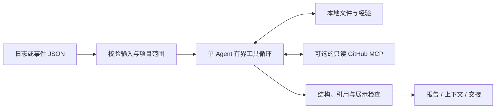

# agent-config-open

**把报错、代码证据和调查过程整理成可继续处理的诊断报告。**

An evidence-grounded CLI agent for error triage, context packaging, and handoff. [English quick start](docs/README.en.md).

这是一个 Python 单 Agent 项目：模型在受限工具循环中读取项目材料，区分事实、假设和缺失证据，输出报告、结构化上下文与交接说明。支持无需 API Key 的离线演示，以及 DeepSeek / Anthropic 真实模型。GitHub 历史问题查询是可选的只读扩展。

## 最近更新（2026-11-03）

- **精确证据窗口**：按当前问题选择相关原文，优先保留反证与必要材料；分别记录实际展示范围和遗漏，不把整份文件算作已读。
- **调查状态保留**：在上下文与交接文件中保留未解决的失败、无新证据的尝试和 `not_run` 检查，减少续接时丢失关键状态。
- **快照续读**：新增 `read_evidence`，从当前运行已捕获的内容继续读取；游标绑定来源版本、字节范围和 hash，不重新请求远端内容。

实现、版本兼容及捕获范围见[上下文选择与快照续读](docs/context-selection.md)。本轮实际检查见[验证记录](docs/verification.md)；真实模型的配对质量、成本和耗时实验为 `not_run`。

## 一分钟运行演示

需要 Python 3.11+ 和 Git。演示使用合成项目及预设模型响应，不联网、不需要 Key。

```bash
git clone https://github.com/P0tenti4L-220/agent-config-open.git
cd agent-config-open
python3 -m venv .venv
.venv/bin/python -m pip install -e '.[dev]'
.venv/bin/agent-triage demo --output local/demo
```

也可以使用锁定依赖安装：

```bash
uv sync --frozen --extra dev
uv run --frozen agent-triage demo --output local/demo
```

Windows PowerShell 使用 `.venv\Scripts\python.exe` 和 `.venv\Scripts\agent-triage.exe`；日常 shell 启动器适用于 macOS / Linux。

演示故意制造 `KeyError: 'items'`：读取器期待 `items`，输入 JSON 提供 `checks`。Agent 会读取日志、读取器和输入文件，生成以下材料。终端 JSON 给出每份文件的实际路径。

| 文件 | 用途 |
|---|---|
| `report.md` | 诊断、事实引用、假设、材料缺口和建议检查 |
| `context.json` | 分层上下文、调查状态与省略说明 |
| `handoff.md` | 交给下一位开发者或下一次会话继续处理 |
| `checks.json` | 已执行检查与 `not_run` 项 |
| `trace.jsonl`、`evidence/`、`request-views/` | 回查调用、证据来源及实际进入模型请求的片段 |

`partial` 表示生成了分析但仍有材料缺口；例如未配置 GitHub 时会说明远端未检查。只有 `failed` 表示本次分析失败。演示通过不代表真实模型诊断质量已经验证。

## 分析自己的报错

先完成安装，然后创建本机配置：

```bash
mkdir -p local
cp examples/deepseek.toml local/config.toml
export DEEPSEEK_API_KEY='<your-key>'

.venv/bin/agent-triage analyze \
  --project-root /path/to/your/project \
  --symptom-file /path/to/your/project/logs/failure.log \
  --project-id my-project \
  --goal "分析这次报错，区分事实与假设，给出下一步验证建议" \
  --config local/config.toml \
  --output local/runs
```

日志必须是项目目录内的 UTF-8 `.log` / `.txt` / `.md` 文件，最大 2 MiB。`--project-id` 是使用者自选的本地别名。配置里的模型名需要在自己的服务商账号中可用；可以直接修改 `model`。

macOS / Linux 可用 `sh scripts/run-agent.sh analyze ...`：自动使用 `.venv`、`local/config.toml`，默认输出到 `local/runs/`；可选加载 `local/deepseek.env` / `local/github.env`，其中只放自己创建的 shell 变量。已导出的凭据优先。`--help`、`--version` 不加载凭据文件。

其他配置：

- [Anthropic](examples/anthropic.toml)：设置 `model` 和 `ANTHROPIC_API_KEY`。
- [只读 GitHub MCP](examples/github-mcp.toml)：填写仓库、MCP 可执行路径与本机 Token。详见[使用说明](docs/usage.md)。
- [分层 Issue 检索](examples/github-layered.toml)：在只读 MCP 基础上显式启用当前项目 → 依赖上游 → 公共回退，并为依赖配置可信仓库映射。
- [事件 JSON](examples/event.json)：更精确地指定报错文件和相关文件；对应项目文件可由 `demo` 生成。

## 工作原理



模型只能调用八个工具：`read_file`、`search_workspace`、`get_git_context`、`search_lessons`、`github_search_issues`、`github_read_issue`、`record_issue_assessment`、`read_evidence`。`read_evidence` 只读取当前运行已经登记的快照，不接受任意路径或 URL；`record_issue_assessment` 只提交逐项适用性判断，由程序校验候选与证据后再更新检索状态。项目路径、搜索仓库、工具参数、模型请求次数、工具次数和运行时间由程序限制。恢复运行保留累计预算。

开启 `issue_research.mode = "layered"`（需要 `schema_version = 2`）后，程序按“当前项目 → 配置中映射的依赖上游 → `is:public` 公共层”逐层搜索，每个候选先读取正文再要求逐项评估；搜索范围、依赖仓库和扩大层级的时机都不由模型文本决定。候选回执绑定本次运行的查询与证据快照，跨仓库 Issue 保留真实 `owner/repo#number`。找到适用线索不会自动升级为已确认根因。

这是诊断助手：不自动修复业务源码、不执行任意 shell，也不发布 issue。建议的检查保留 `not_run`；模型自评不能代替外部复核。

## 开发与验证

```bash
.venv/bin/python -m pytest -m 'not live' -q
.venv/bin/agent-triage doctor --profile offline --output local/doctor
.venv/bin/agent-triage eval --cases tests/cases --output local/eval
# 用上条命令返回的实际目录替换占位符
.venv/bin/agent-triage accept --profile offline --evidence-dir local/eval/<evaluation_id>
python3 scripts/check-public.py
```

真实模型 / GitHub 测试必须显式开启；不会因为机器上存在凭据而自动运行。`doctor` 检查环境准备度，`eval` 执行案例，`accept` 只读取已有证据。它们的具体含义见[验收说明](docs/agent-acceptance-profiles.md)。本地命令结果不等于已接入 CI 或分支保护。

## 目录

```text
src/agent_triage/    CLI、Agent 循环、工具、契约、上下文、评测
tests/              单测、合成案例、本地假 MCP、显式启用的 live 测试
examples/           无凭据的配置与合成事件
docs/               架构、使用、安全边界、验收与后续工作
scripts/            日常启动器与公开内容检查
local/              使用者自己的配置和输出（Git 忽略）
```

运行时敏感材料保留在自己的机器上。**真实模型分析会把选中的日志与代码片段发送给配置的模型服务商**；请先确认有权使用这些材料。脱敏规则只覆盖有限模式，不能保证识别所有业务秘密；详见[数据与安全边界](docs/privacy.md)。

公开版使用独立历史，只包含代码、合成测试和通用文档。[本次验证](docs/verification.md)记录实际执行结果；[后续工作](docs/NEXT_STEPS.md)可作为新会话入口。

## License

[MIT](LICENSE)。
